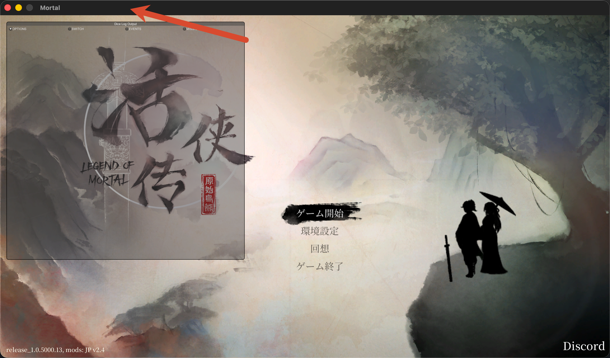

[返回首页](../README.md) · [繁體中文](guide.zht.md) · [日本語](guide.ja.md) · [한국어](guide.ko.md)

> **本文对应游戏 1.06（Build `25953419`，64 位）。** 2026 年 10 月 15 日在本机验证。
> - 从 1.05 升级上来、Mod 突然全部失效：直接看 [从 1.05 升级到 1.06](#upgrade)。
> - 还在用 1.05（Build `20337760`，32 位）：看文末的 [1.05 历史配置](#legacy)。
{: .callout}

本指南面向在 Apple Silicon Mac 上游玩自购正版《活侠传》的玩家：用 Sikarugir、Wine 与 Windows 版 Steam 安装游戏，并处理图形初始化、商店文字缺失、Mod 无法加载等常见问题。

* 目录
{:toc}

## 已验证环境

| 项目 | 已验证配置 |
| --- | --- |
| 游戏 | Steam AppID `1859910`，Build `25953419`，1.06 |
| Unity | `2020.3.49f1` |
| 游戏程序 | `Mortal.exe`、`UnityPlayer.dll`，PE32+ / x64 |
| 包装器运行组件 | Sikarugir Creator `1.0.2`、Template `1.0.22` |
| Wine | Sikarugir Wine `10.0 revision 8` |
| 图形后端 | 模板配套 DXMT `v0.80-244-g7c8dee1`，D3D11 → Metal |
| Mod 入口 | Doorstop `4.4.0` Windows x64（`winhttp.dll`） |
| Mod 框架 | BepInEx `6.0.0-be.785` Unity.Mono 托管核心 |
| 验证日期 | 2026-10-15 |

这套环境是在 1.05 时期建好的 Wine prefix 上升级而来，字体、注册表与 DLL override 都沿用当时的配置。Wine、Steam、macOS 与游戏本身的更新都可能影响结果；调整任何配置前，请记录版本号并做带时间戳的备份。

## 常见症状速查

只在遇到对应症状时执行对应章节。游戏运行正常就不需要额外修复。

| 症状或需求 | 对应章节 |
| --- | --- |
| 首次安装 | [1. 建立 Windows 版 Steam 包装器](#install) |
| 更新到 1.06 后 Mod 同时失效 | [从 1.05 升级到 1.06](#upgrade) |
| 启动闪退 / D3D11 错误 | [2. 修复 D3D11 图形初始化失败](#graphics) |
| 画面模糊或 UI 过小 | [3. Retina 与分辨率](#retina) |
| 商店单价与总额空白 | [4. 修复商店价格显示空白](#fonts) |
| Mod 未生效 / 报错 | [5. 安装与修复 BepInEx Mod](#mods) |
| 想装日文 Mod | [6. 日文 Mod v2.5](#jpmod) |
| 切换窗口后键盘鼠标无响应 | [7. 已知问题](#focus) |
| 长时间挂机、睡眠唤醒 | [8. 日常运维建议](#daily) |
| 检查当前环境 | [9. 只读检查脚本](#diagnostics) |

## 核心名词

| 名词 | 简要说明 |
| --- | --- |
| 包装器（Wrapper） | macOS 上的 `.app` 程序包，里面封装了 Wine 和 Windows 程序。 |
| Wine / Wine prefix | Wine 让 Windows 程序在 macOS 上运行；prefix 是包装器内部模拟的 Windows 环境（虚拟 C 盘和注册表）。 |
| Winetricks | 往 prefix 里安装 Windows 运行库和字体的辅助工具。 |
| DXMT | 把 Direct3D 11 图形指令翻译成 Apple Metal 的转换层。 |
| BepInEx | Unity 游戏常用的 Mod 加载框架。 |
| Doorstop | Mod 的入口工具。它以 `winhttp.dll` 的身份在游戏启动时被加载，再把 BepInEx 带进游戏。 |
| 原生 DLL / 托管 DLL | 原生 DLL（如 `winhttp.dll`）必须和游戏同为 64 位；托管 DLL（C# 写的 BepInEx 与 Mod 插件）大多不区分位数。 |

<a id="install"></a>

## 1. 建立 Windows 版 Steam 包装器

准备：

- Apple Silicon Mac，macOS 14 或更高版本，已安装 Rosetta 2；
- [Sikarugir](https://github.com/Sikarugir-App/Sikarugir)（Creator 与 Template 选用最新版，本机验证为 Creator `1.0.2` / Template `1.0.22`）；
- 个人 Steam 账户中已购买的[《活侠传》](https://store.steampowered.com/app/1859910/Legend_of_Mortal/)；
- 足够的磁盘空间（包装器、Steam、游戏本体约 12 GB，另需备份空间）。

用 Sikarugir Creator 创建独立包装器（例如 `SteamWin.app`），然后在它自己的 Wine prefix 中依次：

1. 初始化 prefix，确认同时有 `Program Files` 与 `Program Files (x86)`；
2. 通过 Winetricks 安装 `cjkfonts`；
3. 设置注册表 `hidewineexports=enable`；
4. 安装 Windows 版 Steam，并把启动目标设为 `C:\Program Files (x86)\Steam\steam.exe`；
5. 登录 Steam，下载 AppID `1859910`。

macOS 原生 Steam 和 Windows 版 Steam 可以共存。登录或联网异常时，先彻底退出另一端的客户端，避免同一账号的会话互相顶掉。

### 确认游戏是 64 位

在 macOS 终端运行（把 `/path/to/LegendOfMortal` 换成实际游戏目录）：

```bash
file "/path/to/LegendOfMortal/Mortal.exe"
```

1.06 的结果：

```text
PE32+ executable (GUI) x86-64, for MS Windows
```

`PE32+` / `x86-64` 表示 64 位。后面所有**原生**组件（`winhttp.dll`、DXMT 模块）都要选 64 位版本。如果显示的是 `PE32` / `Intel 80386`，说明你仍是 1.05，请看 [1.05 历史配置](#legacy)。

<a id="upgrade"></a>

## 从 1.05 升级到 1.06

1.06 把 `Mortal.exe` 与 `UnityPlayer.dll` 从 32 位改成了 64 位。按旧版指南装过的 Mod 入口 `winhttp.dll` 仍是 32 位，64 位游戏会跳过它，改用 Wine 自带的 `winhttp.dll`，于是 **游戏能启动，但所有 Mod 同时失效**。只需要换掉这一个文件。

> 实际操作只换 `winhttp.dll`。`doorstop_config.ini`、`BepInEx/unstripped_corlib`、`BepInEx/core`（be.785）、DiceMaster、存档扩展等托管插件**全部保留**。不要因为游戏换成 64 位就整套替换 BepInEx。
{: .callout .warn}

1. **存档并退出**：在游戏内存档退出，再从 Windows 版 Steam 菜单 `Steam → Exit` 退出。
2. **备份**：复制游戏目录中的 `winhttp.dll`、`doorstop_config.ini` 和整个 `BepInEx` 目录到带时间戳的文件夹；另外单独复制一份存档（`drive_c/users/<用户名>/AppData/LocalLow/Obb Studio/Mortal`）。
3. **确认位数**：
   ```bash
   file "/path/to/LegendOfMortal/Mortal.exe"
   file "/path/to/LegendOfMortal/winhttp.dll"
   ```
   若前者是 `PE32+ … x86-64`、后者是 `PE32 … Intel 80386`，就是本问题。
4. **换入 x64 Doorstop**：从 [UnityDoorstop 4.4.0 发布页](https://github.com/NeighTools/UnityDoorstop/releases/tag/v4.4.0) 下载 Windows 版，取其中 **x64** 目录的 `winhttp.dll`，覆盖游戏根目录的同名文件。
5. **确认 DLL override 仍在**：在包装器的 `winecfg` 中，Applications 标签选 `Mortal.exe`，Libraries 标签里应有 `winhttp = native,builtin`。
6. **启动并看本次日志**：打开 `BepInEx/LogOutput.log`，先确认修改时间晚于本次启动（旧日志会造成误判），再确认包含：
   ```text
   Process bitness: 64-bit (x64)
   Chainloader initialized
   Chainloader startup complete
   ```
7. **在游戏里实际确认功能**：日志出现 `Loading [插件名]` 只说明插件开始加载，功能是否可用要进游戏检查。

本机按此步骤修复后，DiceMaster `1.0.0` 与存档扩展 `1.2.0` 均恢复加载；存档扩展已确认可用，DiceMaster 的选项收益提示已确认显示。DiceMaster 的数值准确性、新剧情解析和骰点控制仍待验证。

**可选：同时升级运行组件。** 本机在同一天把包装器从 Template `1.0.11` / Wine `10.0` 升级到 Template `1.0.22` / Wine `10.0 revision 8`。这一步和修 Mod 入口无关，建议分开做、分开备份，方便判断是哪一步出了问题。Wine `11.0 revision 1` 在本机卡在 `wineboot` 初始化，暂不推荐。

完整排查过程、验证范围和回退方法见 [1.06 升级案例](cases/game-1.06.zhs.md)。

<a id="graphics"></a>

## 2. 修复 D3D11 图形初始化失败

典型症状：Steam 显示“运行中”后游戏很快退出，或 `Player.log` 中出现：

```text
Failed to initialize graphics.
d3d11: failed to create device and context (80004005)
```

1. 打开包装器设置，在图形设置中开启 DXMT；
2. 启动游戏，确认能进入主菜单。

若开启后仍报错，先用 `WINEDEBUG=+loaddll` 日志确认 DXMT 是否真的被加载。只有确认没被加载时，才手动替换 Engine 中的模块：

1. 从日志确认实际生效的 Engine 目录；
2. 备份原有 64 位 WineD3D 模块并记录 SHA-256；
3. 把对应版本的 DXMT 模块（`d3d10core.dll`、`d3d11.dll`、`dxgi.dll`、`winemetal.dll`）放入 `x86_64-windows` 目录；
4. 把匹配的 `winemetal.so` 放入 `x86_64-unix` 目录；
5. 记录替换后的 SHA-256。

成功时 `Player.log` 会显示：

```text
Direct3D:
    Version:  Direct3D 11.0 [level 11.1]
    Renderer: Apple <GPU>
```

日常启动建议用 `steam.exe -applaunch 1859910`。

<a id="retina"></a>

## 3. Retina 与分辨率

Wine Retina 模式的注册表项：

```text
HKCU\Software\Wine\Mac Driver\RetinaMode = "Y"
```

Retina 与游戏 UI 缩放是两回事，《活侠传》的 UI 基本不理会 Windows DPI 设置。分辨率越高画面越清晰、UI 越小；分辨率低则 UI 大但会模糊。建议让游戏记住自己选的分辨率（本机为 `1920×1200`），并从启动参数中去掉强制的 `-screen-width` / `-screen-height`。

<a id="fonts"></a>

## 4. 修复商店价格显示空白

症状：中文对话、普通数值和铜钱图标都正常，只有商店的单价与总额是空白。

1. 彻底退出 Windows 版 Steam；
2. 备份 `drive_c/windows/Fonts`、`system.reg`、`user.reg`、`userdef.reg`；
3. 打开 Winetricks，安装 `fonts → allfonts`；
4. 重启包装器，启动游戏确认商店金额显示正常。

<details markdown="1">
<summary>原因与测试记录</summary>

`MoneyValue` / `MoneyText` 组件使用内嵌字体 `SourceHanSerifTC-Bold`，字体图集也包含 `0–9`，问题出在 prefix 的字体集合与字体映射不完整。初始 prefix 只有 `sourcehansans.ttc` 和 `unifont.ttf`；安装 `allfonts` 后增至 121 个文件（约 284 MB），数量因环境而异。

各字体有各自的许可证。请通过 Winetricks 从原始来源安装；本仓库不分发任何字体。

</details>

<a id="mods"></a>

## 5. 安装与修复 BepInEx Mod

### 加载流程

1. **Doorstop**：Wine 加载游戏目录里的 `winhttp.dll`，由它启动 BepInEx Preloader；
2. **Preloader**：加载 Unity 基础库（corlibs）并准备环境；
3. **Chainloader**：依次加载 `BepInEx/plugins/` 下的 Mod。

三个环节在 Wine 下各有一个坑，对应下面三步。已经在 1.05 时期装好、只是升级到 1.06 的玩家，只需看 [从 1.05 升级到 1.06](#upgrade)。

### 安装前的检查

对每个 Mod 压缩包：

1. 检查包内路径，排除绝对路径和 `..`；
2. 用 `file` 确认 `winhttp.dll` 等原生 DLL 是 64 位（`PE32+`）；
3. 列出会被覆盖的文件，先复制到带时间戳的备份目录；
4. 解压后核对 SHA-256；
5. 启动后确认 `LogOutput.log` 是本次启动生成的。

> 含日文文件名的压缩包请用 Finder 或 `ditto -x -k` 解压。macOS 自带的 `unzip` 会在日文文件名处报错并留下残缺文件。
{: .callout}

### 第一步：让 Wine 加载 Doorstop

Wine 默认优先用自带的 `winhttp.dll`。在 `winecfg` 的 Applications 标签选 `Mortal.exe`，再到 Libraries 标签添加：

```text
winhttp = native,builtin
```

游戏目录中的 `winhttp.dll` 必须是 64 位。本机验证的是 [UnityDoorstop 4.4.0](https://github.com/NeighTools/UnityDoorstop/releases/tag/v4.4.0) Windows **x64** 版。

### 第二步：提供完整 corlibs

游戏自带的 `Mortal_Data/Managed/mscorlib.dll` 是裁剪版（`3,906,048` 字节）；Unity `2020.3.49f1` 的完整版为 `4,065,792` 字节。把合法获取、版本一致的完整 corlibs 放入 `BepInEx/unstripped_corlib/`，并编辑 `doorstop_config.ini`：

```ini
[General]
enabled = true
target_assembly = BepInEx\core\BepInEx.Unity.Mono.Preloader.dll

[UnityMono]
dll_search_path_override = "BepInEx\unstripped_corlib;BepInEx\core"
```

corlibs 必须与 Unity 版本完全一致，并遵守 Unity 的许可；本仓库不分发 corlibs。1.06 下是否仍必需尚未单独验证，本机验证的配置保留了它。

### 第三步：使用包含 Wine 修复的 BepInEx 6

旧版 BepInEx 6（如 `be.692`）在 Wine 下可能抛出：

```text
InvalidOperationException:
Cannot set the value of PlatformHelper.Current once it has been accessed.
```

该问题见 [BepInEx issue #1201](https://github.com/BepInEx/BepInEx/issues/1201)，已在 [PR #1254](https://github.com/BepInEx/BepInEx/pull/1254) 修复。请先备份 `BepInEx/core`，再换成 `6.0.0-be.785` 的 Unity.Mono 核心。

本机实际使用的是 be.785 托管核心 + Doorstop 4.4.0 x64 `winhttp.dll`。托管核心不区分位数，所以 1.05 时期装的 be.785 在 1.06 下可以继续使用；全新安装可以直接用 BepInEx 的 win-x64 包，但请确认包内 `winhttp.dll` 是 64 位。

成功时日志包含：

```text
BepInEx 6.0.0-be.785
Process bitness: 64-bit (x64)
Chainloader initialized
```

<a id="jpmod"></a>

## 6. 日文 Mod v2.5

日文 Mod v2.5 已改为面向 64 位游戏，并加入了游戏内更新功能。它的 README 要求“全部覆盖”，但在 Mac 上整包覆盖会把 BepInEx 核心换回旧的 `be.692`，`doorstop_config.ini` 也会失去 `unstripped_corlib` 路径。

**已实测（2026-10-15）：** 按 README 全部覆盖后，只需两步：① 把 `BepInEx/core` 换回覆盖前的 be.785；② 把 `doorstop_config.ini` 改为 `dll_search_path_override = "BepInEx\unstripped_corlib;BepInEx\core"`。之后日文 Mod、DiceMaster 与存档扩展共 8 个插件全部加载、无报错；v2.5 自带的 64 位 `winhttp.dll` 可直接使用。只覆盖不修改时，be.692 会以 `PlatformHelper.Current` 错误中止，所有 Mod 失效。

Mac 上的安装步骤和验证结果见日文页面：[日本語化 Mod v2.5 を Mac で導入する](cases/japanese-mod-v2.5.ja.md)。

<a id="focus"></a>

## 7. 已知问题：切换窗口后需点击标题栏

从其他 macOS 应用切回《活侠传》后，画面正常刷新，但键盘、鼠标或手柄可能没有反应。

1. 切回 `Mortal` 游戏窗口；
2. 单击窗口顶部的深色标题栏一次（下图红色箭头处）；
3. 回到游戏继续操作。



关闭 Steam 全局 Overlay 与本游戏的 Overlay 可以降低发生频率。该现象在 1.05 实机复现并确认解决方法；1.06 下尚未专门复测。根因仍在排查，符合 Wine、Unity 与 macOS 之间焦点传递异常的特征。

<a id="daily"></a>

## 8. 日常运维建议

- 关闭 Steam 全局 Overlay 和本游戏的 Overlay。
- 游玩时可用 `caffeinate` 防止系统休眠。合盖休眠、锁屏或插拔外接显示器后，建议存档并重启游戏、Steam 和包装器。
- 退出时先在游戏内存档，再用 Windows 版 Steam 的 `Steam → Exit`。Dock 里的 Wine 图标只是窗口代理。
- Windows 版 Steam 长时间挂在后台后可能不再响应 `-applaunch`。若 `gameprocess_log.txt` 没有新记录，重启本包装器的 Steam 与 Wine 会话。

<a id="diagnostics"></a>

## 9. 只读检查脚本

```bash
skills/run-legend-of-mortal-on-mac/scripts/inspect-lom-wrapper.sh \
  "/path/to/SteamWin.app"
```

脚本只读取包装器配置、游戏架构、Steam 清单、注册表、字体数量、DXMT 模块哈希、BepInEx 日志和当前进程，不会启动或结束任何进程，也不修改文件。脚本在[项目仓库](https://github.com/li-yifei/legend-of-mortal-mac-guide)中。

## 让 AI 助手协助

不熟悉 Wine 或终端的读者，可以把本指南交给 AI 编码助手，让它先只读检查本机环境，再按症状处理。请遵守：

- Steam 由自己手动登录，不向 AI 提供账号密码或令牌；
- 文件替换和有风险的命令先人工确认；
- 修改 Engine、prefix 或游戏目录前先做带时间戳的备份。

<a id="legacy"></a>

## 1.05 历史配置

<details markdown="1">
<summary>1.05（Build <code>20337760</code>，32 位）的验证环境与差异</summary>

2026-08-29 验证：

| 项目 | 配置 |
| --- | --- |
| 游戏 | Build `20337760`，`release_1.0.5000.13` |
| 游戏程序 | `Mortal.exe`，PE32 / x86 |
| 包装器 | Sikarugir Template `1.0.11`，Wine `10.0` |
| 图形后端 | 32 位 DXMT |
| Mod | Doorstop x86 `winhttp.dll`，BepInEx `6.0.0-be.785` x86 Mono |

与 1.06 的差异：

- `file Mortal.exe` 显示 `PE32 executable (GUI) Intel 80386`；
- 原生组件全部选 32 位：`winhttp.dll` 用 x86 版，手动替换 DXMT 时放入 `i386-windows` / `i386-unix`；
- D3DMetal 只覆盖 64 位，不能用于 1.05；DXMT 提供 32 位 D3D10/11 模块；
- 日文 Mod v2.4 与 DiceMaster 的加载过程见 [日文 Mod v2.4 案例](cases/japanese-mod.zhs.md)。

</details>

## 参考资料

- [Sikarugir](https://github.com/Sikarugir-App/Sikarugir)
- [DXMT](https://github.com/3Shain/dxmt)
- [UnityDoorstop 4.4.0](https://github.com/NeighTools/UnityDoorstop/releases/tag/v4.4.0)
- [BepInEx Wine 修复（PR #1254）](https://github.com/BepInEx/BepInEx/pull/1254)
- [《活侠传》日文 Mod](https://dlaqe2334.github.io/LOM-JPMOD/)
